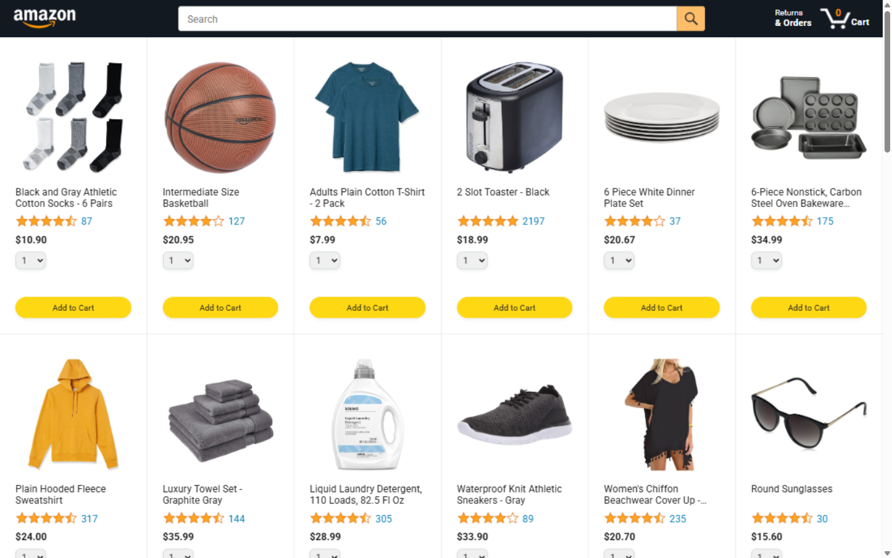
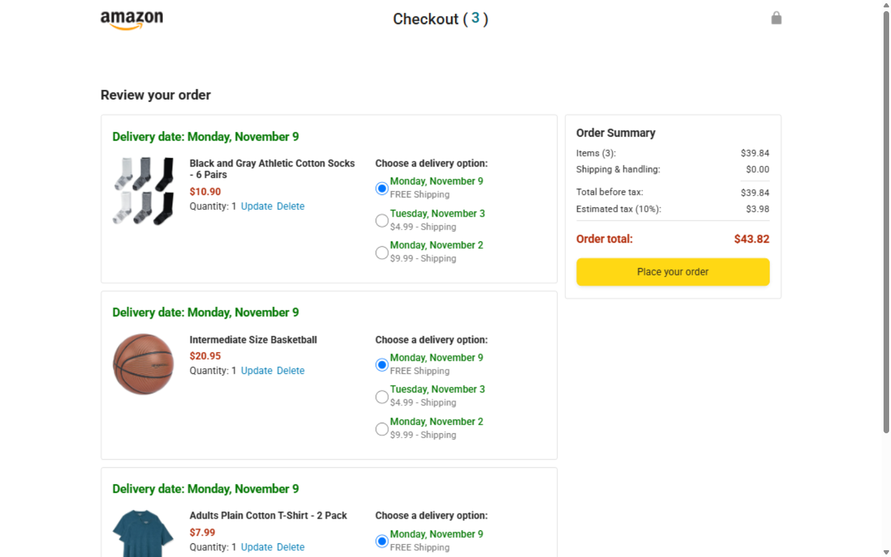
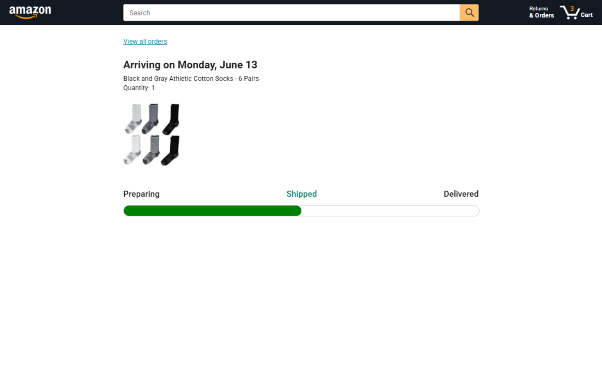

# Amazon Clone

A **front-end clone of Amazon** built with **vanilla HTML, CSS, and JavaScript** (ES Modules, no framework, no build step). It replicates Amazon's storefront UI: a product grid, a persistent shopping cart, and a checkout page with delivery options and order totals.

🔗 **Live demo:** [https://alijamshidy.github.io/amazon-clone/](https://alijamshidy.github.io/amazon-clone/) — automatically deployed to GitHub Pages on every push to `main` via [`.github/workflows/static.yml`](.github/workflows/static.yml).

---

## 📸 Screenshots

| Storefront (`/`) | Checkout (`/checkout.html`) |
|------------------|------------------------------|
|  |  |

| Order tracking (`/tracking.html`, static demo) |
|------------------------------------------------|
|  |

---

## ✨ Features

### 🛒 **Shopping**
- Product catalog — 42 products rendered in a responsive grid (7 breakpoints: mobile → desktop)
- Add to cart with quantity selector (1–10 per item)
- Cart persisted in `localStorage` (key: `cart`) — survives page reloads
- Star-rating display for every product

### 💳 **Checkout**
- Order summary with per-item delivery dates
- 3 delivery options: free (7 days), $4.99 (3 days), $9.99 (1 day)
- Delivery-date calculation with **Day.js** (weekend skipping)
- Payment summary with item cost, shipping, and **10% estimated tax**

### 📄 **Pages**
- `index.html` — storefront / product grid
- `checkout.html` — order + payment summary
- `orders.html` / `tracking.html` — static demo pages for order history and shipment tracking (progress-bar UI)

---

## 🛠 Tech Stack

- [HTML5](https://developer.mozilla.org/en-US/docs/HTML/HTML5) + [CSS3](https://developer.mozilla.org/en-US/docs/Web/CSS)
- [JavaScript (ES6+)](https://developer.mozilla.org/en-US/docs/Web/JavaScript) with **native ES Modules** — no bundler, no `package.json`
- [Day.js](https://day.js.org/) — bundled locally (`scripts/dayjs.min.js`)
- [Roboto](https://fonts.google.com/specimen/Roboto) via Google Fonts — the only external dependency
- Data is hardcoded as an ES-module array in `data/products.js`

---

## 💻 Installation

> ⚠️ **A local HTTP server is required.** All pages load JavaScript as ES modules, and module imports are blocked on `file://` URLs (CORS) — opening `index.html` directly in the browser will **not** work.

1. **Clone the repository:**
   ```bash
   git clone https://github.com/alijamshidy/amazon-clone.git
   cd amazon-clone
   ```

2. **Start any static file server:**
   ```bash
   # Python
   python -m http.server 8000

   # or Node.js
   npx serve -p 8000

   # or PHP
   php -S localhost:8000
   ```

3. **Open in browser:**
   ```
   http://localhost:8000
   ```

No environment variables are needed — the app is fully static and makes no network requests.

---

## 📁 Folder Structure

```
amazon-clone/
├── index.html              # Storefront / product grid
├── checkout.html           # Order + payment summary
├── orders.html             # Order history (static demo)
├── tracking.html           # Shipment tracking (static demo)
├── data/                   # Frontend data (ES modules)
│   ├── cart.js             # Cart state + localStorage persistence
│   ├── deliveryOptions.js  # Delivery options & pricing
│   └── products.js         # Product catalog (42 items)
├── scripts/
│   ├── amazon.js           # Storefront logic
│   ├── checkout.js         # Checkout page bootstrap
│   ├── checkout/           # orderSummary.js, paymentSummary.js, CheckoutHeader.js
│   ├── utils/money.js      # Cent → dollar formatting
│   └── dayjs.min.js        # Day.js (bundled)
├── styles/
│   ├── pages/              # Page-specific styles
│   └── shared/             # Shared/global styles
├── images/                 # Product, icon, and rating images
├── backend/products.json   # Unused copy of the product data
└── .github/workflows/      # GitHub Pages deployment
```

---

## 🚀 Demo

1. Browse the product grid on the homepage
2. Pick a quantity and **Add to Cart**
3. Open the cart and proceed to **checkout**
4. Choose a delivery option and review the payment summary (shipping + 10% tax)

> ℹ️ The "Place your order" button and the search bar are currently non-functional — see [Known Limitations](#-known-limitations).

---

## 🚧 Known Limitations

This is a front-end learning project, so some UI is intentionally not wired up yet:

- The **search bar** renders but has no event handler — search is not implemented
- There is **no product details page** — product cards are not links
- **"Place your order"** does not create an order (checkout is display-only)
- The cart badge on `orders.html` / `tracking.html` is hardcoded (those pages are static demos)
- No authentication, no backend, no filtering — good next steps, see the roadmap below

---

## 🎯 Roadmap

- [x] Amazon-like UI and product grid
- [x] Shopping cart with localStorage persistence
- [x] Checkout with delivery options and tax calculation
- [x] GitHub Pages deployment
- [ ] Wire up search and a product details page
- [ ] Real "place order" flow with order persistence
- [ ] Backend API integration

---

## 🤝 Contributing

Contributions are welcome! Please follow these steps:

1. Fork the repository
2. Create your feature branch (`git checkout -b feature/AmazingFeature`)
3. Commit your changes (`git commit -m 'Add some AmazingFeature'`)
4. Push to the branch (`git push origin feature/AmazingFeature`)
5. Open a Pull Request

---

## 📜 License

This project is public and open for educational use.

---

## 🆘 Support

For support, please open an issue or contact the maintainer.

---

## 🏷 Topics

`html`, `css`, `javascript`, `amazon-clone`, `ecommerce`, `frontend`, `vanilla-js`, `es-modules`, `responsive-design`, `shopping-cart`, `checkout`, `static-website`
